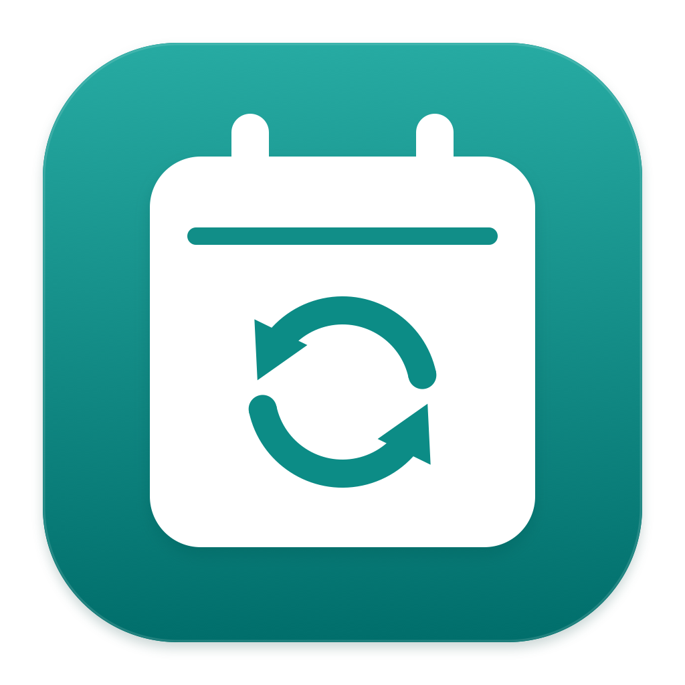

# Calendar Sync



Copy selected events between the calendars already connected to your Mac. Keep work flights in iCloud, or show family commitments as busy time on your work calendar. Preview every rule, test a single change, then opt into automatic syncing.

Calendar Sync is a native macOS menu-bar app. It uses Apple Calendar's account connections through EventKit, with no hosted service, separate calendar passwords, or Microsoft Graph app registration. **Both accounts must work in Apple Calendar; signing into them only in Outlook is insufficient.** It is a companion app, not an Outlook add-in.

## Download and install

**[Download v0.1.3 preview](https://github.com/wgtndan/outlookFlightSync/releases/tag/v0.1.3)** · macOS 14 or later · [MIT license](LICENSE)

1. Download the ZIP for your Mac:
   - **[Apple Silicon — arm64](https://github.com/wgtndan/outlookFlightSync/releases/download/v0.1.3/Calendar-Sync-v0.1.3-macos-arm64.zip)** for Macs with an Apple M-series chip.
   - **[Intel — x86_64](https://github.com/wgtndan/outlookFlightSync/releases/download/v0.1.3/Calendar-Sync-v0.1.3-macos-x86_64.zip)** for Intel Macs.
2. Unzip it and drag **Calendar Sync.app** into **Applications**. If you cannot install for all users, put it in the **Applications** folder inside your home folder (`~/Applications`); create that folder if needed.
3. Open Calendar Sync from the folder where you installed it.
4. Choose **Allow Calendar access**, then allow full access when macOS asks. Both reading source events and updating destination copies require it.

This preview is **ad-hoc signed, not Developer ID signed or notarized**. macOS may block the downloaded app because its developer cannot be verified. If you trust this release, first try opening it, then go to **System Settings → Privacy & Security → Open Anyway**, and confirm **Open**. This is Apple's supported per-app exception; availability can depend on your Mac's management policy. Do not use this procedure for a warning that the app contains malware or is damaged—download a fresh copy and report the issue. See [Apple's guidance on opening downloaded apps](https://support.apple.com/en-us/102445). Building from source is also supported below.

Each release includes `SHA256SUMS`. To check the downloaded ZIP against it, run the following from the folder containing both files and compare the matching filename's hash:

```sh
shasum -a 256 Calendar-Sync-v0.1.3-macos-*.zip
cat SHA256SUMS
```

No Xcode or developer tools are needed to run the downloaded app. The Intel binary is cross-compiled and its architecture and signature are checked; runtime validation for this release was performed on Apple Silicon.

## Set up your first rule

1. Check that both calendars are visible and syncing in Apple Calendar, and that the destination is writable. [Apple's account setup guide](https://support.apple.com/guide/calendar/add-calendars-and-calendar-accounts-icl4308d6701/mac) explains how to connect accounts.
2. In Calendar Sync, choose a preset and name the rule.
3. Select a source and destination calendar. The pickers include the account name.
4. Adjust conditions on the title, location, or notes. Match **all** or **any** conditions using contains, starts with, equals, or does not contain.
5. Choose **Test & preview**. Expand **Notes** to inspect copied text. The default window is the previous **7 days** and next **180 days**.
6. To try one event, choose **Apply this change** on its row and confirm. The remaining changes stay in the refreshed preview.
7. Choose **Apply all changes**, or **Confirm this preview** when nothing needs changing, to approve the complete rule. You can then enable **Keep it in sync**.

Automatic syncing checks every five minutes while the app runs and catches up after the Mac wakes. It only creates and updates events; removals always need a manual preview and confirmation. Editing a rule pauses automatic syncing until you review it again. Applying a single row does not approve the whole rule for automatic syncing.

Add separate rules for different calendar pairs. Closing the window leaves the app running in the menu bar; reopen it from there, the Dock, or Command-Tab. Enable **Open at login** if you want it to start automatically. Nothing syncs while the app is quit or your Mac is asleep.

## What gets copied

| Preset | Matching | Destination copy |
| --- | --- | --- |
| Flights | Titles starting with `Flight for ` and containing `Airline Confirmation Code:` | Title, dates/times, location and notes |
| Family commitments | Your selected conditions | `Family Commitment` and busy time; no original title, location or notes |
| Custom rule | Your selected conditions | Title, dates/times, location and notes |

For example, the flight preset matches this fictional title:

> Flight for Example Traveller from Example City to Sample City, Example Air: XX123, Airline Confirmation Code: SAMPLE

Notes are copied as text exposed by macOS Calendar. Adding, editing or clearing source notes updates existing managed copies. Attachments, Outlook-specific rich formatting, attendees and reminders are not copied, and the app does not send meeting invitations. Recurring events become individual copies of occurrences within the sync window.

**The family preset does not set Outlook's actual Private/sensitivity flag.** It removes descriptive details, which is not equivalent to marking an Exchange event Private. EventKit does not expose the required setter in the API used here.

The source is authoritative: edits to a managed destination copy may be replaced on the next sync. The app records mappings locally and marks its copies in their URL field. It does not adopt or overwrite unrelated destination events. Managed copies are excluded from source matching to prevent loops between rules. Keep their URL markers intact so ownership can be verified.

## Update or uninstall

To update, quit Calendar Sync from its menu-bar menu, download the new release and replace the app in the same Applications folder. Open the new copy. Your rules and mappings stay in Application Support. macOS may ask you to renew Calendar access after an update to an ad-hoc signed build.

When updating from a version before 0.1.3, automatic flight/custom rules pause until you confirm a new full preview: these rules now copy notes too. Existing copies receive notes when you apply their proposed updates.

To uninstall, turn off **Open at login**, quit the app, and move **Calendar Sync.app** from its Applications folder to the Trash. This leaves your calendar events and local rules/mappings intact. Uninstalling the app does not remove events it previously copied. Keeping the local state allows a later installation to recognize its existing mappings.

## Privacy and local data

Rules, approvals and event mappings are stored at:

```text
~/Library/Application Support/CalendarSync/state.sqlite
```

Mappings can contain copied event details, including notes. Calendar Sync uses macOS for account authentication and provider synchronization; it does not store OAuth tokens or calendar passwords or send your calendar data to an app-operated server. The app needs full Calendar access to read and reconcile events; write-only access is insufficient. See [Apple's EventKit access documentation](https://developer.apple.com/documentation/eventkit/accessing-the-event-store).

Please use fictional events in bug reports. Do not upload a real state database, calendar export, booking reference, or unredacted screenshot to a public issue.

## Troubleshooting and current limits

- **Missing or stale calendar:** check Apple Calendar first. Calendar Sync can only see what macOS has synchronized. Review permission in **System Settings → Privacy & Security → Calendars**.
- **Exchange connection stops working:** Apple's October 2026 guidance says Exchange Online EWS changes may require an administrator to allow Apple Internet Accounts. Contact your Exchange administrator if the account stops signing in or syncing in Apple Calendar. Calendar Sync cannot bypass that account policy. See [Apple's Exchange sign-in guidance](https://support.apple.com/en-us/149092).
- **Old interrupted copy:** version 0.1.1 fixed the first prototype's post-save verification failure. Keep your existing rule and run **Test & preview**. The app can recover a matching marked copy without creating another event; apply the reviewed preview to finish recovery.
- **Rescheduled event needs review:** some older source identities include the event's start time. If rescheduling changes that identity, the app pauses for review instead of creating a duplicate or deleting the old copy. Fully automatic migration of these identities is not implemented yet.
- **A removal is waiting:** this is intentional. Automatic sync never removes copies; review and apply removals manually.

This is an early preview. Test a rule with **Apply this change** before enabling automatic syncing. For implementation details, see [architecture and limits](docs/ARCHITECTURE.md).

## Build from source

Use macOS 14 or later with a Swift 6 or newer toolchain and the macOS SDK, supplied by a compatible Xcode or Command Line Tools installation. The project uses system frameworks and SQLite, with no third-party packages.

```sh
git clone https://github.com/wgtndan/outlookFlightSync.git
cd outlookFlightSync
swift test
./scripts/build-app.sh release
open build
```

Drag the generated **Calendar Sync.app** into Applications and launch that bundle. Do not launch the bare Swift executable: the bundle carries the identity and usage descriptions needed for macOS permissions. The build script ad-hoc signs the app; it does not install or launch it, request Calendar access, or enable login items. Use `debug` instead of `release` for a debug build.

To inspect the UI using fictional data without accessing real calendars, launch your installed bundle with `--demo` (adjust the path if installed in `~/Applications`):

```sh
open -n "/Applications/Calendar Sync.app" --args --demo
```

Cloud-synced folders can add Finder metadata that invalidates strict code-signature checks. In that case, put the build output outside the synced folder:

```sh
CALENDAR_SYNC_BUILD_DIR="$HOME/Library/Caches/CalendarSync/Builds" ./scripts/build-app.sh release
open "$HOME/Library/Caches/CalendarSync/Builds"
```

To build release ZIPs and checksums for both architectures:

```sh
./scripts/package-release.sh
```

Output goes to `build/release`. Use `--arch arm64` or `--arch x86_64` to package one architecture. Building both binaries does not test Intel runtime behavior on an Apple Silicon Mac.

The app icon's vector source is `scripts/generate-app-icon.swift`; regenerate it with `swift scripts/generate-app-icon.swift`. `swift test` uses synthetic events and temporary databases and does not request Calendar access. GitHub Actions runs tests and packages build artifacts; publishing a GitHub release is a separate step.

## Contributing

[Open an issue](https://github.com/wgtndan/outlookFlightSync/issues) for bugs or ideas, or send a pull request. Include your macOS version, app version and a minimal example using fictional events. Run `swift test` before submitting a code change. The project is available under the [MIT license](LICENSE).
